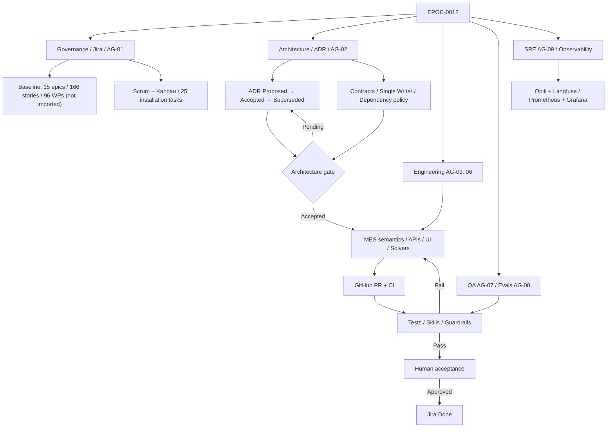
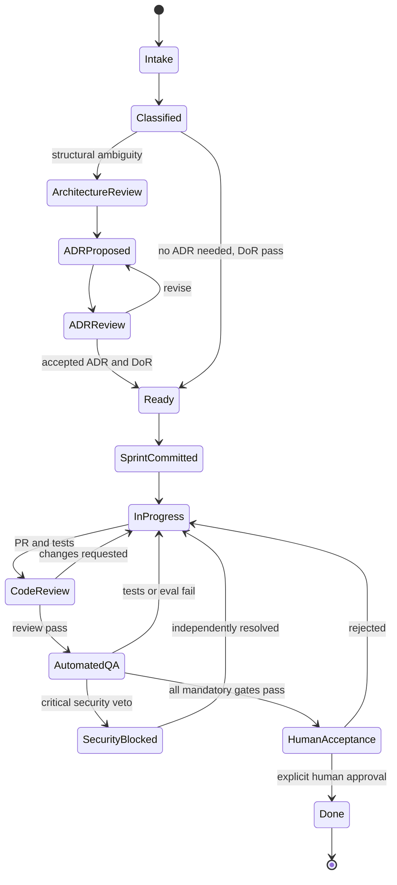
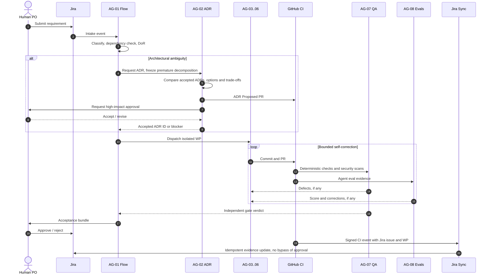
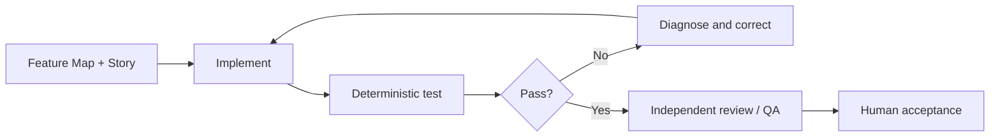
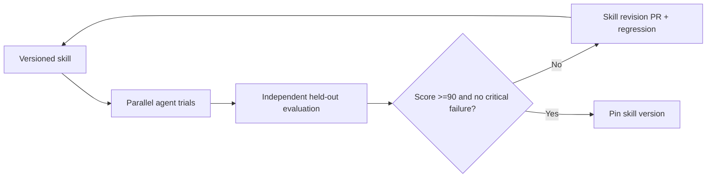
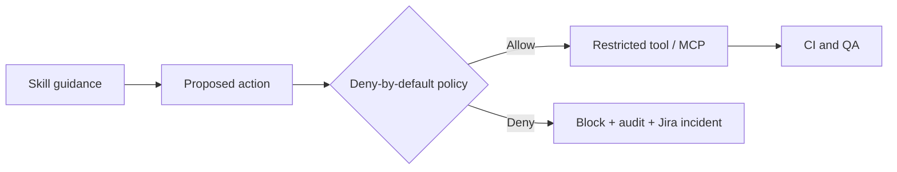
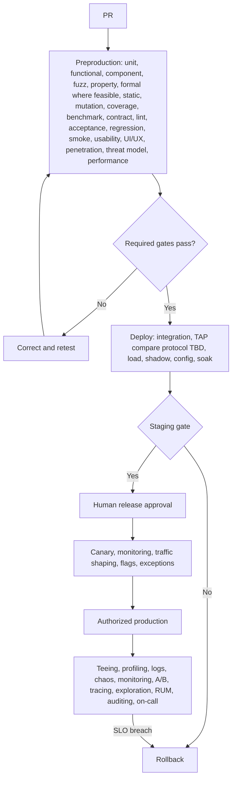

# EPOC-0012 — StateChart maestro y control de entrega
Status: Proposed | Jira Cloud: not connected | Product Owner approval: publication authorized once, architectural acceptance pending

## Systems of record
Jira: epics, stories, WP mapping, sprint, status and acceptance. GitHub: ADR, code, PR, tests and evidence. Opik and Langfuse: model/agent traces. Prometheus and Grafana: operational metrics and dashboards. Never claim a synthetic test is a live Jira/LLM integration.

## Program At-a-Glance

## Story lifecycle

## Decision and implementation sequence

## Agent behavior
AG-01 owns what/who/when; AG-02 owns why/trade-offs; AG-03 MES; AG-04 backend; AG-05 frontend; AG-06 solvers; AG-07 QA/security veto; AG-08 LLM evaluation; AG-09 DevOps/SRE. Nine logical identities share one authorized integration identity, not nine Jira accounts.

### Engineering correction loop

### Skill improvement loop

### Hard guardrails

No agent may alter its own safety policy, test oracle or approval evidence to obtain a passing score.

## Verification and release

This is a control taxonomy; listed tests are not necessarily implemented.

## Jira installation checklist (all unverified until Jira connection)
INS-001 branch status; 002 Docker/WSL/Compose; 003 Python tests; 004 monitoring stack; 005 Jira site; 006 EPOC12 project; 007 Scrum/Kanban boards; 008 issue types; 009 agent/WP/run/evidence fields; 010 GitHub integration; 011 15 epics; 012 166 stories; 013 96 WP links; 014 Sprint 0; 015 DoR/DoD; 016 REST/MCP auth; 017 9 logical identities; 018 idempotent Jira Sync; 019 CI status mapping; 020 E2E issue/PR/test/Jira; 021 Opik/Langfuse trace correlation; 022 Prometheus Jira metrics; 023 Grafana delivery dashboard; 024 security/cost/alerts; 025 retrospective.

## Dashboard contract
Show real Jira counts by status, sprint, epic, WP, blocked dependencies, ADR state, agent score/retries, CI failures, QA veto, latency p95, errors, token costs and SLOs. Mark unavailable integrations as NOT CONNECTED; do not display planned counts as completed.
