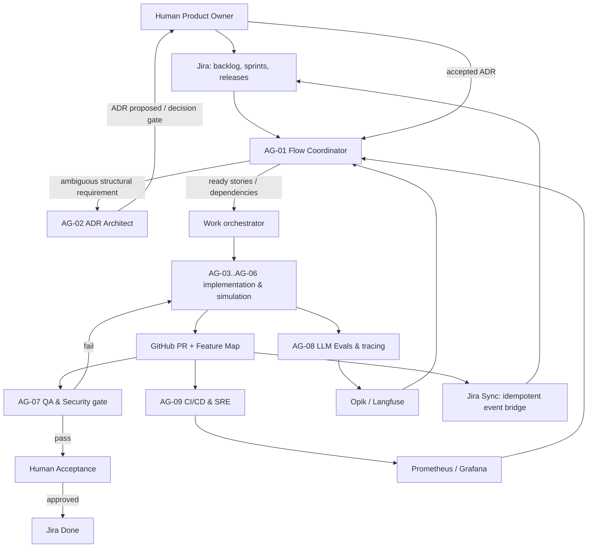
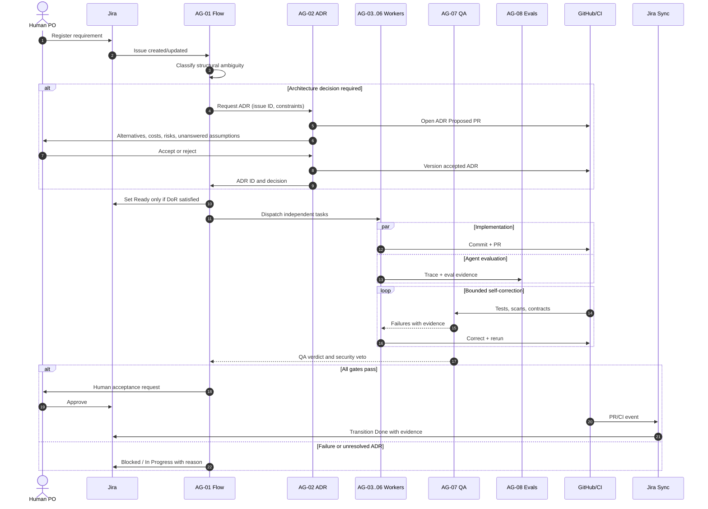

# EPOC-0012 — Governance & execution architecture

Status: Proposed | Owner: Human Product Owner | Version: 0.1 | Scope: SAP ME-compatible synthetic pilot

## System of record
- Jira Cloud: epics, stories, tasks, bugs, sprint, priorities, dependencies, workflow and approvals.
- GitHub: code, ADRs, feature map, pull requests, test reports, immutable commit references.
- Opik + Langfuse: agent/model tracing and comparative evaluations.
- Prometheus + Grafana: numerical metrics, alerting and dashboards.
- AG-01 manages **what/who/when**, never technical choices; AG-02 owns **why/options/trade-offs**, never sprint status.
- Human PO approves high-impact architecture, security exceptions, production access, budgets and acceptance. Agents are logical identities, not nine Jira seats.

## Governance and execution (Mermaid)

## Sequence: ambiguous requirement to Done

## Agent governance matrix
| ID | Agent | Owns | Artifact | Must not do |
|---|---|---|---|---|
| AG-01 | Scrum Master & Flow Coordinator | backlog, sprint, blockers, dependencies | Jira issue/sprint | choose architecture or bypass DoR |
| AG-02 | Enterprise & ADR Architect | alternatives, decisions, TOGAF, contracts | ADR in Git | manage sprint or self-accept high-impact ADR |
| AG-03 | SAP ME/MES Specialist | manufacturing semantics, routes, WIP | domain schemas | design numerical solver |
| AG-04 | Backend & Integration Engineer | API, persistence, service contracts | FastAPI/OpenAPI | override accepted ADR |
| AG-05 | Frontend & Visualization Engineer | UX, UI tests | views/feature map | embed business logic |
| AG-06 | Simulation & Optimization Engineer | SimPy/SciPy/Pyomo/Ipopt/OpenModelica | solver artifacts | invent SAP semantics |
| AG-07 | QA & Security Auditor | independent test/security gates | verdicts, risk reports | approve own failing build |
| AG-08 | LLM Evaluation & Observability | model eval, cost, traces | Opik/Langfuse datasets | replace deterministic engineering checks |
| AG-09 | DevOps & SRE | CI, Docker, Prometheus/Grafana | pipelines, dashboards | deploy without QA and authorization |

## ADR trigger rule
AG-01 flags: new persistent data model, contract breaking change, solver strategy, security boundary, cloud vs local, observability provider, irreversible migration, cost above approved budget. AG-02 checks existing accepted ADRs and proposes a superseding ADR if needed. Missing evidence => unresolved question, not guessed answer.

## Security boundaries
- Only Jira Sync holds Jira write credentials; agents submit structured events to it.
- AG-07 can block release; only human can override via documented, time-bounded exception.
- GitHub PR checks are not equivalent to human acceptance.
- No SAP production access; no untrusted MCP shell/file/network execution.
- No Jira API, Opik, Langfuse or other secret in code or traces.
